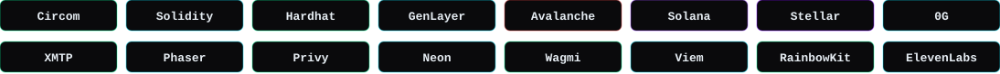
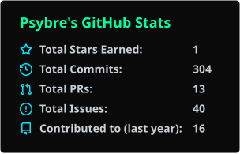
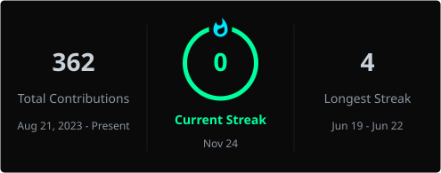
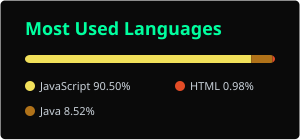

  

   

  

   

  <em>Estudiante de ATI en el TEC · Fundador de ZEEK · Cartago, Costa Rica</em>

    

  
  &nbsp;
  
  &nbsp;
  
  &nbsp;
  

 

  
  

I am a 22-year-old Information Technology Administration student at **Tecnológico de Costa Rica** and the founder of **[ZEEK](https://www.zeek.es/)**, a Web3 builder community in Costa Rica. I work mainly on backend and product — TypeScript, Python, and zero-knowledge circuits — and I learn fastest by shipping with a team under hackathon pressure.

Open to internships in IT, software, and data, and to Web3 community or builder roles.

 

  
  

### [Proven](https://github.com/proven-xyz/proven-app) · Team Lead

AI-powered 1v1 prediction challenges whose intelligent contract reads web evidence and settles on GenLayer.

[Repository](https://github.com/proven-xyz/proven-app) · [Live demo](https://proven-app.vercel.app)

### [ArkChain](https://github.com/ArkChain-Labs/ArkChain) · Backend

Private secondary-market infrastructure for equity crowdfunding in LATAM, with selective disclosure via eERC20 and Circom.

[Repository](https://github.com/ArkChain-Labs/ArkChain) · [Live demo](https://ark-chain.vercel.app)

### [VoiceFi](https://github.com/VoiceFi/voicefi-app) · Backend

Voice-first money app on Solana — talk to move and check balances, with Privy auth.

[Repository](https://github.com/VoiceFi/voicefi-app) · [Live demo](https://voicefi-app.vercel.app)

### [Zegon](https://github.com/Zegon-Labs/Zegon-DApp) · UI

Provably fair pixel-art duel against a blindfolded AI, with on-chain commit-reveal on 0G.

[Repository](https://github.com/Zegon-Labs/Zegon-DApp) · [Play](https://www.zegonduel.com)

### [Cora](https://github.com/cora-fi/Cora) · Solo builder

Decentralized health mutual fund on Stellar: members pool capital, earn yield, and settle claims to hospitals on-chain.

[Repository](https://github.com/cora-fi/Cora) · [Live demo](https://cora-protocol.vercel.app/)

### [Bylo](https://github.com/Psybre/Bylo) · Solo

Conversational AI that turns quoting and booking appointments into a thirty-second chat flow, with a lightweight CRM.

[Repository](https://github.com/Psybre/Bylo) · [Live demo](https://bylo-ivory.vercel.app)

### [ZEEK](https://github.com/ZEEKCR) · Founder

Builder community I founded in Costa Rica — events, teams, and a public hub for students shipping Web3 projects.

[Organization](https://github.com/ZEEKCR) · [Hub](https://zeek-hub.vercel.app) · [Website](https://www.zeek.es/)

 

  
  

Tools I actually used across Proven, ArkChain, VoiceFi, Cora, Zegon, Bylo, and university work (Java, Express, PostgreSQL). Web3-specific tooling is in the row below.

  

    

  

 

  
  

  
  
  

Official language stats only cover repositories under my personal account. Most hackathon work lives in organizations — the stack above is the accurate picture.

  

 

  
  

- **Speaker** — Ethereum Cypherpunk Congress (Web3Privacy Now), Mumbai. Privacy and security communities in Costa Rica and Latin America.
- Competed at **AImpacto**, Madrid
- Competed at **HackMeridian** (Stellar), Lisbon
- Competed at **ETHGlobal**, Mumbai
- Competed at **Aleph Hackathon**, Buenos Aires
- Founder and organizer, **ZEEK**, Costa Rica

 

  
  

- LinkedIn: [linkedin.com/in/esteban-brenes-108227359](https://www.linkedin.com/in/esteban-brenes-108227359)
- Email: [brenesjosuee@gmail.com](mailto:brenesjosuee@gmail.com)
- GitHub: [github.com/Psybre](https://github.com/Psybre)
- ZEEK: [zeek.es](https://www.zeek.es/)

   
  
  <code>root@psybre:~$ logout</code>

